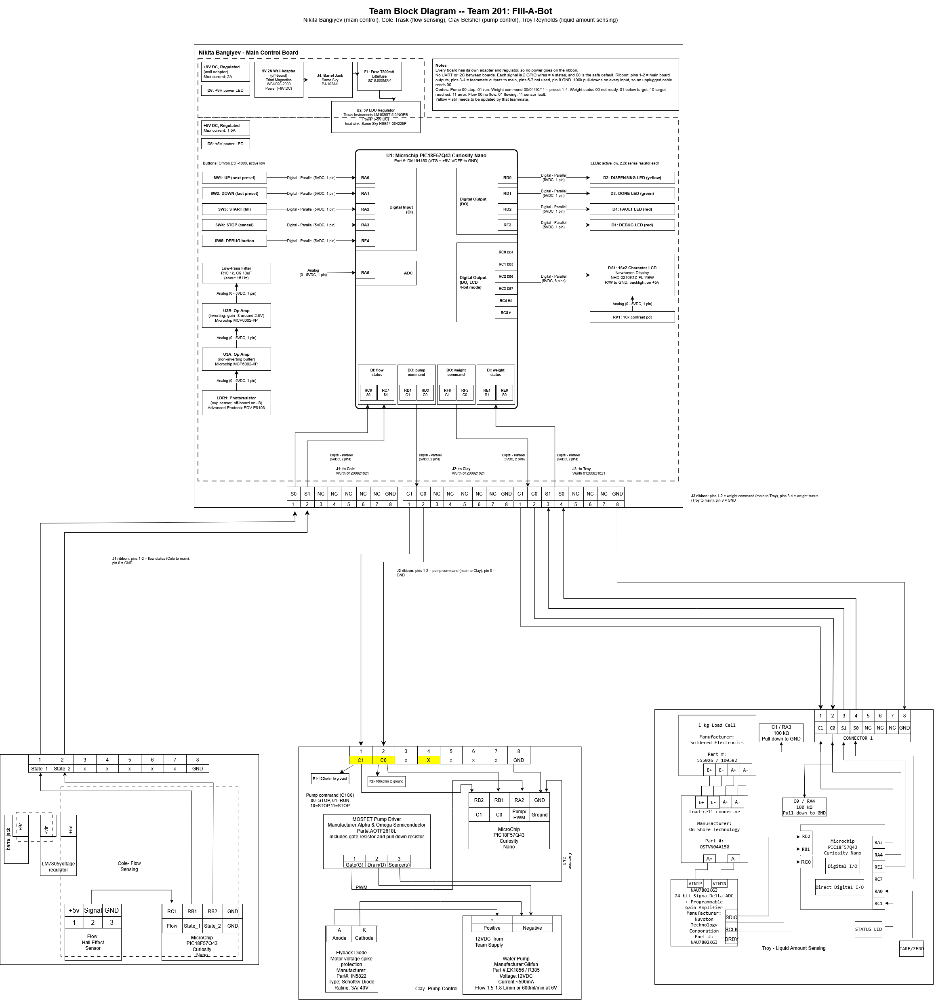

## Introduction

Fill-A-Bot is an automated liquid dispensing system designed to measure and dispense a selected amount of liquid. The system is divided into multiple subsystems responsible for user control, pump operation, flow sensing, and liquid amount sensing. Each subsystem uses a PIC18F57Q43 Curiosity Nano and connects to the main controller through the team's 8-pin ribbon cable. The team block diagram documents how these subsystems are connected and what signals pass between them.

## System Architecture

Fill-A-Bot uses a hub-and-spoke architecture consisting of one main controller and three subsystems. The main controller is the central point for the Pump Control, Flow Sensing, and Liquid Amount Sensing subsystems, and each subsystem has its own ribbon cable to the main controller.

The boards don't use UART, I2C, or SPI. Each signal between two boards is 2 plain GPIO wires driven high or low, so it has 4 states (00, 01, 10, 11). This matches the I/O table in our [Software Proposal](07-Software%20Proposal.md) flow chart:

| Board | Inputs (4-state) | Outputs (4-state) | Signals |
| --- | --- | --- | --- |
| Main Control (Nikita) | 2 | 2 | Out: pump command, weight command. In: weight status, flow status |
| Pump Control (Clay) | 1 | 0 | In: pump command |
| Liquid Amount Sensing (Troy) | 1 | 1 | In: weight command. Out: weight status |
| Flow Sensing (Cole) | 0 | 1 | Out: flow status |

Each board has its own wall adapter and 5V regulator, so no power is shared over the ribbon cable.

## Team Block Diagram

The team block diagram below shows the electrical architecture of the Fill-A-Bot system, including the main controller and the Pump Control, Flow Sensing, and Liquid Amount Sensing subsystems. Items highlighted in yellow still need to be updated by that teammate.

{ width="100%" }

Figure 1: Team block diagram (click to enlarge)

Source files: [team-block-diagram-source.zip](image/BlockDiagram2.zip) [draw.io file](image/BlockDiagram2.drawio)

## Why We Chose This Structure

We first planned I2C and then UART between the boards. On Oct 22 we switched to plain 2-wire signals (the professor suggested it). Every signal we need fits in 4 states, so we don't need a serial protocol, baud rates, or addresses. Each line can be checked with an LED or a meter, which makes testing each board on its own much easier. The tradeoff is that the user can't type in any amount anymore, so we use 4 fill presets instead.

## How It Meets the Requirements

- **Select the amount (2.1, 3.1, 4.1):** The user picks 1 of 4 presets with the buttons on the main board. The main board sends the preset to the weight board as a 2-wire code.
- **Monitor and stop at the target (2.2, 2.3, 6.4):** The weight board compares the scale reading to the preset target (the container weight is hard-coded for the demo) and reports "target reached". The main board then tells the pump board to stop.
- **Start and stop flow automatically (1.2):** The main board turns the pump on and off with the pump command. The pump board only runs the pump while the command is 01.
- **No unintended dispensing (2.6):** 00 is the safe default on every signal and every input has a pull-down, so an unplugged cable reads 00 and the pump stays off. If the flow board reports no flow while pumping, the main board stops the pump and flashes the Fault LED.
- **Stop at any time (6.1, design 1.5 and 3.4):** The STOP button on the main board sets the pump command to stop from any step.
- **Feedback and status (2.1 display, 3.3, 3.4):** The main board's LCD shows the preset and the status (Ready, Filling, Finished), and LEDs show Dispensing, Done, and Fault.
- **Repeat cycles (2.4):** After a fill is done, the main board goes back to step 1 without a restart.
- **Zeroing (2.5, 4.3):** The weight board has its own tare button.

## Communication

The team uses 8-pin ribbon cables with 2x4 IDC connectors between the main controller and each subsystem. The cable is straight through (pin 1 to pin 1). The pin use follows the class standard: pins 1-5 are digital, pins 6-7 are analog, and pin 8 is ground. On every cable, pins 1-2 are the main controller's outputs and pins 3-4 are the subsystem's outputs back to the main controller.

| Pin | Cole (Flow) | Clay (Pump) | Troy (Liquid Amount) | Main controller pin |
| --- | --- | --- | --- | --- |
| 1 | Not used | Pump command C1 (main to Clay) | Weight command C1 (main to Troy) | RD4 (Clay), RF6 (Troy) |
| 2 | Not used | Pump command C0 (main to Clay) | Weight command C0 (main to Troy) | RD3 (Clay), RF5 (Troy) |
| 3 | Flow status S1 (Cole to main) | Not used | Weight status S1 (Troy to main) | RC7 (Cole), RE1 (Troy) |
| 4 | Flow status S0 (Cole to main) | Not used | Weight status S0 (Troy to main) | RC6 (Cole), RE0 (Troy) |
| 5-7 | Not used | Not used | Not used | |
| 8 | GND | GND | GND | GND |

All boards use 5V logic. Every input gets a 100k pull-down and every output starts low, so each signal starts at 00.

## Signal Codes

| Signal | 00 | 01 | 10 | 11 |
| --- | --- | --- | --- | --- |
| Pump command (main to Clay) | Stop | Run | Not used (stop) | Not used (stop) |
| Weight command (main to Troy) | Preset 1 | Preset 2 | Preset 3 | Preset 4 |
| Weight status (Troy to main) | Not ready | Below target | Target reached | Error |
| Flow status (Cole to main) | No flow | Flowing | Not used (no flow) | Sensor fault |

The team is still picking the four preset amounts.

## References

1. Microchip Technology Inc., *PIC18F57Q43 Curiosity Nano Hardware User Guide*, DS40002186B. [Link](https://ww1.microchip.com/downloads/aemDocuments/documents/MCU08/ProductDocuments/UserGuides/PIC18F57Q43-Curiosity-Nano-HW-UserGuide-DS40002186B.pdf)

2. Microchip Technology Inc., *PIC18F27/47/57Q43 Data Sheet* (I/O ports chapter). [Link](https://ww1.microchip.com/downloads/aemDocuments/documents/MCU08/ProductDocuments/DataSheets/PIC18F27-47-57Q43-Microcontroller-Data-Sheet-XLP-DS40002147.pdf)

3. Same Sky (formerly CUI Devices), *PJ-102AH DC Power Jack*, Datasheet. [Link](https://www.sameskydevices.com/product/resource/pj-102ah.pdf)

4. Texas Instruments, *LM1086 1.5-A Low Dropout Positive Regulator*, Datasheet. [Link](https://www.ti.com/lit/ds/symlink/lm1086.pdf)

5. Newhaven Display, *NHD-0216K1Z-FL-YBW 16x2 Character LCD*, Datasheet. [Link](https://newhavendisplay.com/content/specs/NHD-0216K1Z-FL-YBW.pdf)

6. Microchip Technology Inc., *MCP6001/1R/1U/2/4 1 MHz, Low-Power Op Amp*, DS20001733L. [Link](https://ww1.microchip.com/downloads/en/DeviceDoc/MCP6001-1R-1U-2-4-1-MHz-Low-Power-Op-Amp-DS20001733L.pdf)
