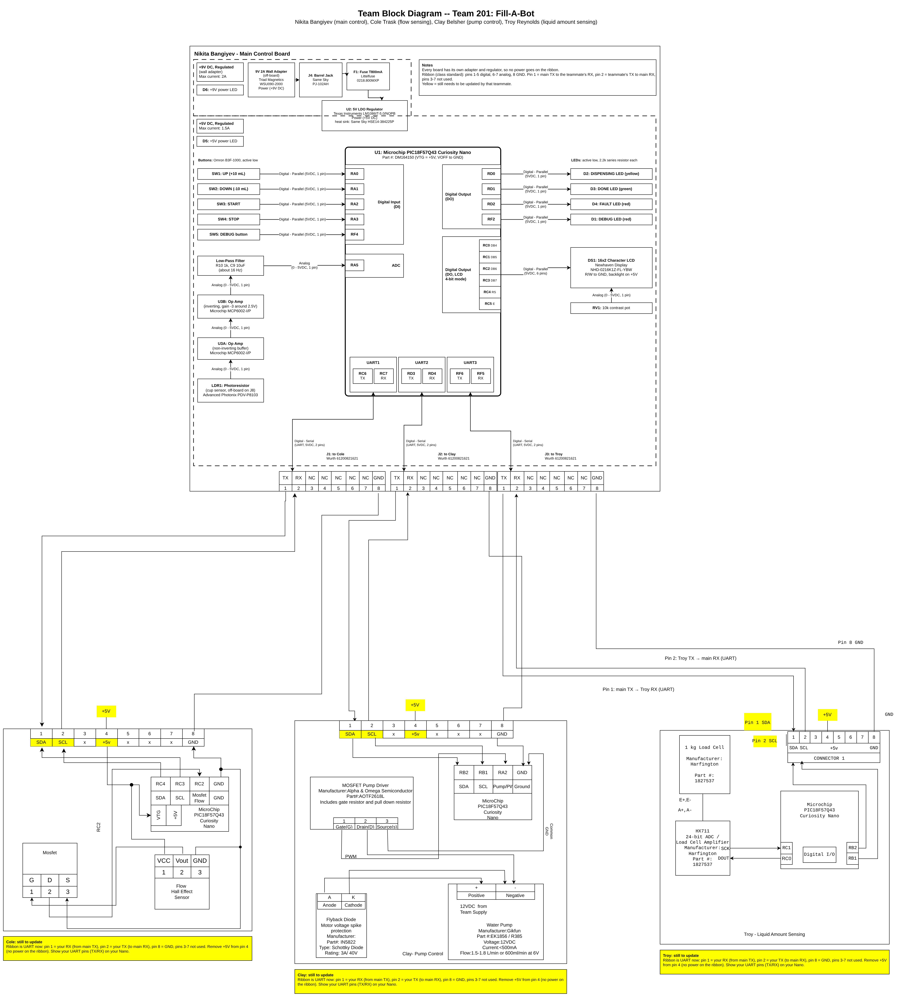

## Introduction

Fill-A-Bot is an automated liquid dispensing system designed to measure and dispense a selected amount of liquid. The system is divided into multiple subsystems responsible for user control, pump operation, flow sensing, and liquid amount sensing. Each subsystem uses a PIC18F57Q43 Curiosity Nano and communicates with the main controller through the team's 8-pin ribbon cable connection. The team block diagram documents how these subsystems are connected and how information is transferred between them using UART.

## System Architecture

Fill-A-Bot uses a hub-and-spoke architecture consisting of one main controller and three subsystems. The main controller serves as the central communication point for the Pump Control, Flow Sensing, and Liquid Amount Sensing subsystems.

The main controller has a separate UART for each teammate: UART1 to Cole (RC6 TX, RC7 RX), UART2 to Clay (RD3 TX, RD4 RX), and UART3 to Troy (RF6 TX, RF5 RX). Each board has its own wall adapter and 5V regulator, so no power is shared over the ribbon cable.

## Team Block Diagram

The team block diagram below shows the electrical architecture of the Fill-A-Bot system, including the main controller and the Pump Control, Flow Sensing, and Liquid Amount Sensing subsystems. Items highlighted in yellow still need to be updated by that teammate.

{ width="100%" }

Figure 1: Team block diagram (click to enlarge)

Source files: [team-block-diagram-source.zip](image/team-block-diagram-source.zip) (draw.io file and PNG)

## Communication

The Fill-A-Bot subsystems communicate using UART. The team uses 8-pin ribbon cables with 2x4 IDC connectors between the main controller and each subsystem. The pin use follows the class standard: pins 1-5 are digital, pins 6-7 are analog, and pin 8 is ground.

| Pin | Function |
| --- | --- |
| 1 | Main controller TX → subsystem RX |
| 2 | Subsystem TX → main controller RX |
| 3 | Not used |
| 4 | Not used |
| 5 | Not used |
| 6 | Not used |
| 7 | Not used |
| 8 | GND |

There's no power pin on the ribbon. Each subsystem has its own UART line to the main controller, so no addresses are needed.

## Message Structure

The UART message structure will be added after the team finalizes the commands and data exchanged between the main controller and each subsystem.

## References

1. Microchip Technology Inc., *PIC18F57Q43 Curiosity Nano Hardware User Guide*, DS40002186B. [Link](https://ww1.microchip.com/downloads/aemDocuments/documents/MCU08/ProductDocuments/UserGuides/PIC18F57Q43-Curiosity-Nano-HW-UserGuide-DS40002186B.pdf)

2. Microchip Technology Inc., *PIC18F27/47/57Q43 Data Sheet* (UART and PPS chapters). [Link](https://ww1.microchip.com/downloads/aemDocuments/documents/MCU08/ProductDocuments/DataSheets/PIC18F27-47-57Q43-Microcontroller-Data-Sheet-XLP-DS40002147.pdf)

3. Same Sky (formerly CUI Devices), *PJ-102AH DC Power Jack*, Datasheet. [Link](https://www.sameskydevices.com/product/resource/pj-102ah.pdf)

4. Texas Instruments, *LM1086 1.5-A Low Dropout Positive Regulator*, Datasheet. [Link](https://www.ti.com/lit/ds/symlink/lm1086.pdf)

5. Newhaven Display, *NHD-0216K1Z-FL-YBW 16x2 Character LCD*, Datasheet. [Link](https://newhavendisplay.com/content/specs/NHD-0216K1Z-FL-YBW.pdf)

6. Microchip Technology Inc., *MCP6001/1R/1U/2/4 1 MHz, Low-Power Op Amp*, DS20001733L. [Link](https://ww1.microchip.com/downloads/en/DeviceDoc/MCP6001-1R-1U-2-4-1-MHz-Low-Power-Op-Amp-DS20001733L.pdf)
